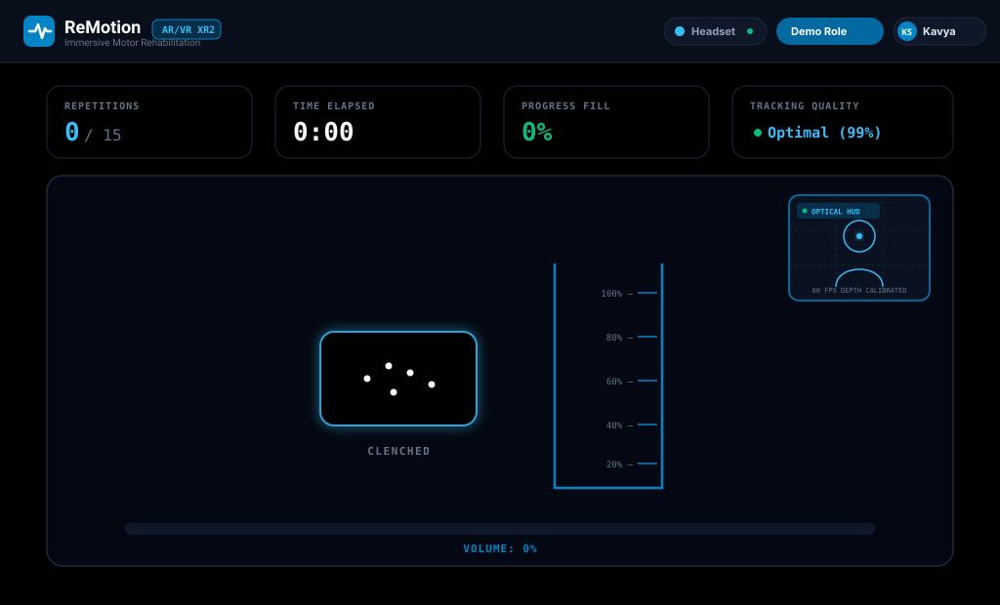
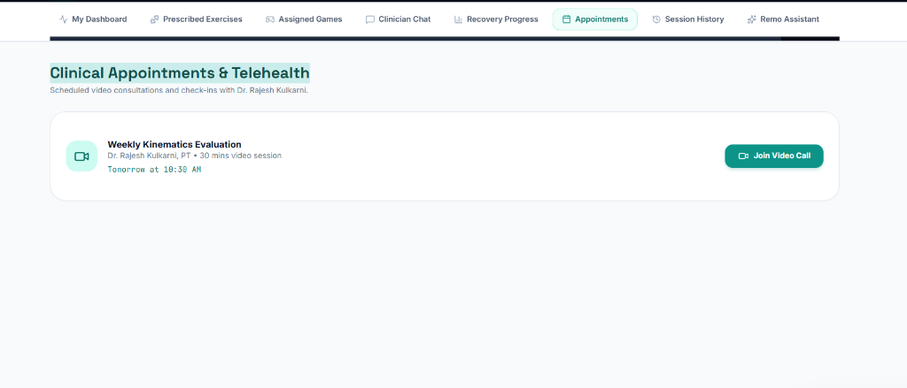
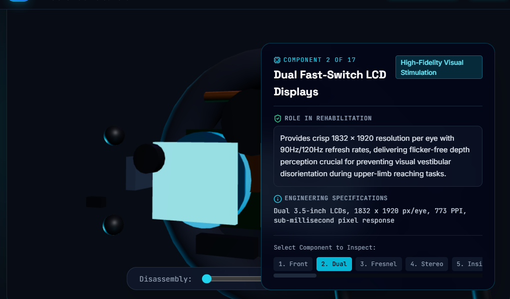
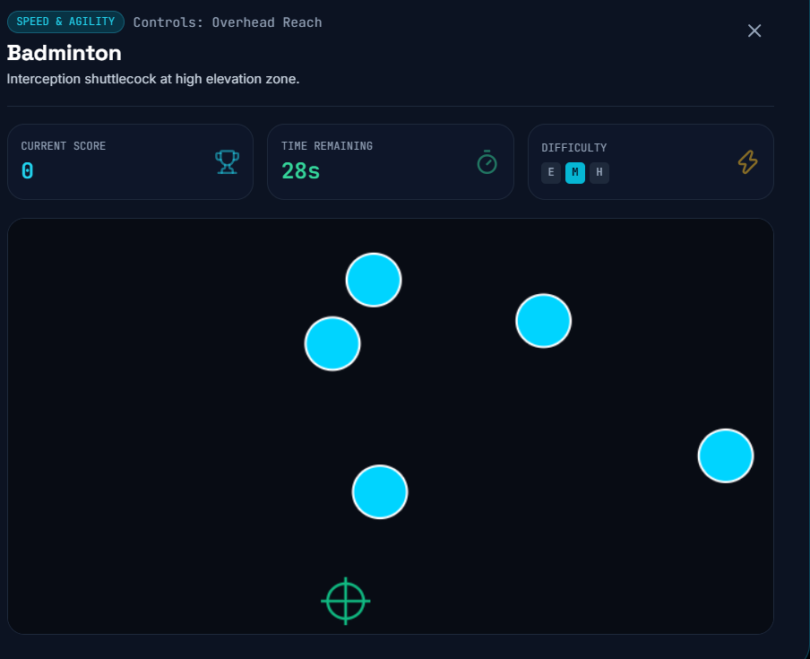
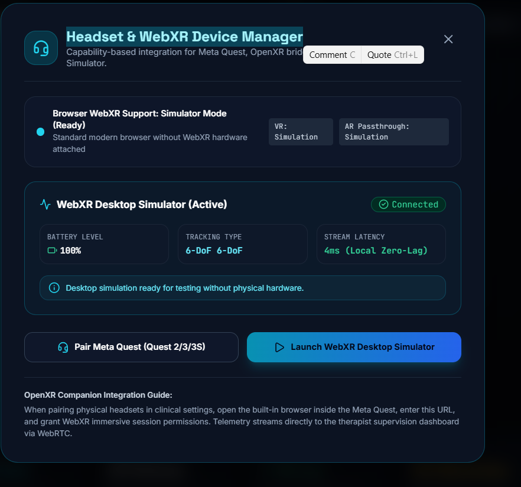

<p align="center">
  
</p>

<p align="center">
  <strong>Next-Generation Mixed Reality (AR/VR) and Computer Vision Motor Rehabilitation Platform</strong>
</p>

<p align="center">
  <a href="https://remotion-rehab.vercel.app"></a>
  <a href="https://github.com/panchaksharayya12/Remotion"></a>
  <a href="https://vercel.com/new/clone?repository-url=https://github.com/panchaksharayya12/Remotion"></a>
</p>

<p align="center">
  
  
  
  
  
  
  
  
</p>

---

## Direct Live Application Link

> ### **[https://remotion-rehab.vercel.app](https://remotion-rehab.vercel.app)**
> **Local Deployment**: `http://localhost:5000`  
> **Repository**: [https://github.com/panchaksharayya12/Remotion.git](https://github.com/panchaksharayya12/Remotion.git)

---

## 1. Executive Summary

**ReMotion** is a comprehensive, full-stack medical rehabilitation platform engineered to accelerate upper-limb motor recovery for patients suffering from post-stroke hemiparesis, traumatic brain injuries, neuromuscular trauma, and orthopedic movement disorders.

By uniting **MediaPipe optical computer vision**, **Three.js WebGL spatial physics**, **peer-to-peer WebRTC telehealth**, and **22 gamified therapeutic routines**, ReMotion transforms physical therapy into an engaging, quantified, and clinically supervised experience.

---

## 2. Four Distinct Dedicated Portals

ReMotion delivers four specialized, purpose-built workspaces under a single unified authentication architecture:

```
                                  +---------------------------+
                                  |      ReMotion Gateway     |
                                  |   (Unified Auth & RBAC)   |
                                  +-------------+-------------+
                                                |
         +------------------+-------------------+-------------------+------------------+
         |                  |                   |                   |                  |
         v                  v                   v                   v                  v
+-----------------+ +-----------------+ +-----------------+ +-----------------+ +-----------------+
| Patient Portal  | |Therapist Portal | | Explorer Portal | |  Admin Portal   | |   Landing /     |
| Friendly Health | |Clinical Command | | 3D VR & Gaming  | | Enterprise Ops  | | Headset Tour    |
| Soft Teal Theme | |Hospital Navy    | |Electric Cyan    | | Slate Executive | | Cinematic HUD   |
+-----------------+ +-----------------+ +-----------------+ +-----------------+ +-----------------+
```

### Portal 1: Patient Recovery Workspace (Friendly Healthcare Theme)
- **Visual Design**: Welcoming, calm clinical teal and soft sky palette designed for patient comfort.
- **Core Features**:
  - Daily recovery streak counter, XP leveling system (Levels 1 to 10), and milestone achievement badges.
  - Real-time prescription feed synchronized via WebSocket (under 15ms latency).
  - One-click launcher for prescribed exercises (**Squeeze & Fill**, **Reach & Touch 3D**, **Hand Dexterity Check**).
  - Floating multilingual **Remo Assistant** supporting voice accessibility and query assistance in English, Hindi, Kannada, Tamil, Telugu, and Hinglish.
  - Telehealth appointment scheduler with instant **Join Video Call** WebRTC room launcher.

<p align="center">
  
  <br />
  <em>Figure 1: Patient Workspace — Real-Time MediaPipe Optical Hand Tracking & Volumetric Fill Squeeze Mechanics.</em>
</p>

---

### Portal 2: Therapist Clinical Command (Hospital Navy Workspace)
- **Visual Design**: Professional, high-density clinical workstation with structured patient caseload tables.
- **Core Features**:
  - Assigned patient caseload registry with instant search, condition filtering, and compliance tracking.
  - Longitudinal recovery curves: Range of Motion (ROM), accuracy percentage, reaction latency (ms), and repetitions.
  - Dynamic **Prescription Builder**: Prescribe exercise repetitions, daily frequency, and clinical guidance with instant WebSocket dispatch to patient dashboards.
  - Integrated **Clinical SOAP Documentation Editor** (Subjective, Objective, Assessment, Plan) with automatic timestamping.
  - Side-by-side **Live Telemetry & Biofeedback Monitor** streaming 60 FPS joint flexion data.
  - Built-in **WebRTC Telehealth Consultation Suite** featuring live two-way camera feeds and real-time speech translation subtitles.

<p align="center">
  
  <br />
  <em>Figure 1: Clinical Telehealth Suite - Direct P2P Video Consultation with Real-Time Subtitles.</em>
</p>

---

### Portal 3: Explorer & VR Gaming Arena (High-Energy Electric Cyan)
- **Visual Design**: Cinematic dark navy and electric cyan aesthetic featuring interactive 3D WebGL visualizations.
- **Core Features**:
  - **17-Component Exploded 3D Mixed Reality Headset**: Interactive spatial viewer showcasing lenses, Snapdragon XR2 compute core, ToF sensors, 6-DoF optical cameras, and IMU units with custom spatial disassembly slider.
  - **22 Playable Motor Rehabilitation Games**: Genuine interactive games engineered to train specific motor functions (reaching, interception, precision pinch, overhead extension, lateral stability).
  - **WebXR Device Manager**: Pairs Meta Quest 2/3/3S headsets or launches desktop 6-DoF simulation mode.

<p align="center">
  
  <br />
  <em>Figure 2: Interactive 3D Headset Exploded-View Inspector - 17 Modular Subcomponents with Spatial Disassembly.</em>
</p>

<p align="center">
  
  <br />
  <em>Figure 3: Gamified Rehabilitation - Badminton High-Zone Interception Training with Upper-Limb Kinematic Tracking.</em>
</p>

---

### Portal 4: Administrator Portal (Enterprise Slate)
- **Visual Design**: Sleek executive slate dashboard providing institutional governance.
- **Core Features**:
  - User and clinician credential management (Patients, Therapists, Administrators).
  - Genuine Microsoft Excel (`.xlsx`) two-way export and import with deduplication logic.
  - Headset & WebXR hardware registry and fleet health telemetry.
  - Complete security audit logging (HIPAA/GDPR compliance trail).
  - One-click clinical database reset to pristine baseline.

<p align="center">
  
  <br />
  <em>Figure 4: Hardware & WebXR Device Manager - Spatial 6-DoF Companion Integration & Stream Latency Telemetry.</em>
</p>

---

## 3. Computer Vision & Biomechanical Tracking

ReMotion executes optical computer vision directly within the browser without requiring specialized external hardware or markers:

```
Webcam Feed (60 FPS) -> MediaPipe HandLandmarker -> 21 3D Landmarks -> Coordinate Mirroring
                                                                           |
                                +------------------------------------------+
                                |
                                v
         +----------------------------------------------+
         |       Real-Time Kinematic Extraction         |
         +----------------------------------------------+
         | * Finger Curl Distance (MCP to Tip)          |
         | * Thumb-Index Precision Pinch Span           |
         | * Wrist Pronation / Supination Rotation      |
         | * Tremor Frequency FFT Spectrum (Hz)         |
         | * Dynamic Clench Calibration Thresholds      |
         +----------------------+-----------------------+
                                |
                                v
         +----------------------------------------------+
         |       Multi-Channel Dispatch Engine          |
         +----------------------------------------------+
         | -> Canvas / Three.js Visual Biofeedback      |
         | -> WebRTC Telehealth Goniometer Overlay      |
         | -> Socket.IO Clinical Broadcast to Therapist |
         | -> SQLite Longitudinal Recovery Storage      |
         +----------------------------------------------+
```

---

## 4. The 22 Playable Rehabilitation Games

Every game targets a specific rehabilitation biomechanic and logs kinematic recovery scores to the patient's record:

| Category | Games Included | Target Biomechanics |
| :--- | :--- | :--- |
| **Upper-Limb Reaching** | Badminton, Tennis, Table Tennis, Fruit Reach | Shoulder flexion, elbow extension, spatial interception |
| **Pinch & Fine Dexterity** | Precision Pinch, Marble Sorter, Key Insertion | Thumb-index opposition, fine motor coordination |
| **Grip & Grasp Strength** | Squeeze & Fill, Power Grip Dynamo, Ball Squeeze | Flexor digitorum recruitment, sustained clench hold |
| **Bilateral Coordination** | Rowing Master, Steering Wheel Drive, Drum Beat | Symmetric arm recruitment, trunk stabilization |
| **Speed & Reaction** | Whack-a-Mole, Space Blaster, Target Shooting | Sensorimotor reaction latency, quick deceleration |
| **Range of Motion (ROM)** | Sky Painter, Rainbow Arc, Balloon Pop | Full overhead abduction, multi-planar range expansion |

---

## 5. Instant Demo Clinical Accounts

To test any portal immediately without registration, use the pre-seeded credentials:

| Portal / Role | Email | Password | Pre-configured Profile |
| :--- | :--- | :--- | :--- |
| **Patient** | `patient@remotion.health` | `patient123` | **Asha Sharma** (Left Hemiparesis, 480 XP, Level 4, 7-Day Streak) |
| **Therapist** | `therapist@remotion.health` | `therapist123` | **Dr. Rajesh Kulkarni, PT** (Senior Neuro-Rehabilitation Specialist) |
| **Administrator** | `admin@remotion.health` | `admin123` | **System Administrator** (Full EMR governance & Excel export/import) |
| **Explorer** | `guest@remotion.health` | `guest123` | **Technology Explorer** (Instant access to 3D Headset & 22 VR Games) |

---

## 6. Technology Stack

- **Frontend Core**: React 18, Vite 5, Tailwind CSS, Lucide SVG Icons.
- **3D Graphics & Physics**: Three.js (WebGL rendering for exploded headset and 3D Reach & Touch).
- **Vision Tracking**: MediaPipe 21-keypoint HandLandmarker with optical gesture analysis.
- **Real-Time Telehealth**: WebRTC P2P mesh with Google STUN (`stun:stun.l.google.com:19302`) and Twilio STUN fallback.
- **Subtitles & Multilingual**: Web Speech API speech-to-text with neural translation across Hindi, Kannada, Tamil, Telugu, and English.
- **Backend**: Node.js, Express.js.
- **WebSockets**: Socket.IO for sub-15ms prescription dispatch and live kinematic streaming.
- **Database**: SQLite via `sql.js` (WebAssembly) with automated persistence to disk.
- **Spreadsheet Engine**: Microsoft Excel (`.xlsx`) generation and parsing via `xlsx`.

---

## 7. Getting Started

### Prerequisites
- Node.js (v18.0.0 or higher)
- npm or pnpm

### Quick Installation

```bash
# 1. Clone the repository
git clone https://github.com/panchaksharayya12/Remotion.git
cd Remotion

# 2. Install backend dependencies
cd server
npm install

# 3. Install frontend dependencies
cd ../client
npm install

# 4. Build frontend production assets
npm run build

# 5. Launch the full-stack server
cd ..
npm start
```

Open your browser to `http://localhost:5000` to launch the platform.

---

## 8. Deployment on Vercel

This repository is pre-configured for automated deployment on **Vercel**:

1. Click the **Deploy with Vercel** button below:
   
   [](https://vercel.com/new/clone?repository-url=https://github.com/panchaksharayya12/Remotion)

2. Or import via the Vercel Dashboard:
   - Root Directory: `./`
   - Framework Preset: **Vite**
   - Build Command: `cd client && npm install && npm run build`
   - Output Directory: `client/dist`

---

## 9. License & Research Attribution

This project is licensed under the **MIT License**.

Built for academic research in mixed-reality neuro-rehabilitation and motor recovery support.
